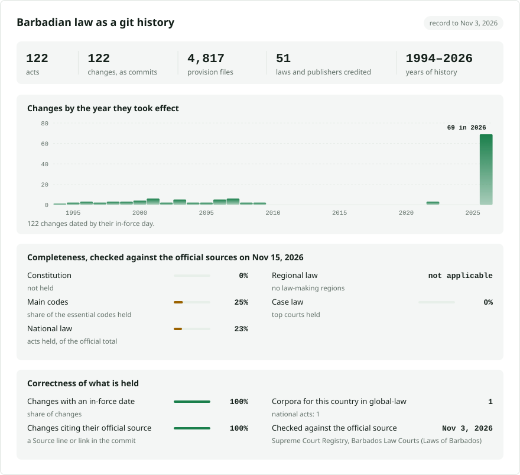

# Barbados: law history in git

<picture>
<source media="(prefers-color-scheme: dark)" srcset="data/effort-dark.svg">

</picture>

The law of Barbados as a git history: one file per section, one commit per version on the day it took effect where the text gives that day, and the Act that made it as the commit's author where the edition names one. `git blame` names the Act (or the publisher) behind every line; `git log` lists every change to a section; picking a date gives the text in force that day.

Part of [lexifina/global-law](https://github.com/lexifina/global-law), one git history for every country's law: this is Barbados' national law, which global-law reads as `bb/national/acts`.

**What is in it now:** the Constitution of Barbados and the consolidated Laws of Barbados (Law Revision Office editions), with their subsidiary legislation, and the Acts and statutory instruments of the 2009 to 2015 annual volumes, one version each so far; more are appended as they are fetched from the Barbados Law Courts. [`STRUCTURE.md`](STRUCTURE.md) gives the layout, [`REPRODUCE.md`](REPRODUCE.md) how it was built, and [`data/held.json`](data/held.json) every PDF not committed, with the reason.

Folders are by type and year: `constitution/`, `revised-laws/cap-NNN-<slug>/` (a chapter of the Laws of Barbados, with its `subsidiary/`), `acts/<year>/<NNN>-<slug>/` and `subsidiary/<year>/<NNN>-<slug>/`, one file per section, schedule and preamble (`revised-laws/cap-326d-revised-laws/cap-326d-consumer-protection/sec-007.md` is section 7, Unfair terms, of the Consumer Protection Act, Cap. 326D).

The text is in English, as the Barbados Law Courts' PDFs print it; marginal notes (section headings and amendment references) are left out where the PDF sets them in smaller type.

## Questions as git commands

| Question | Command |
| --- | --- |
| Every change to section 7 of the Consumer Protection Act | `git log -p --word-diff -- revised-laws/cap-326d-consumer-protection/sec-007.md` |
| Which Act wrote each line of section 7? | `git blame revised-laws/cap-326d-consumer-protection/sec-007.md` |
| Every version of the Act, with the day each took effect | `git log --format="%h %(trailers:key=In-force,valueonly,separator=) %an" -- revised-laws/cap-326d-consumer-protection ':!*/README.md'` |
| Section 7 as in force on 1 January 2015 | `python tools/on.py 2015-01-01 revised-laws/cap-326d-consumer-protection 7` |

**Outside git**, we also host this record publicly, for free:

- **[Ask Claude about Barbadian law](https://global-law.lexifina.com/v1/try_claude?country=barbados)**: opens Claude with a first question ready.
- **[Ask ChatGPT](https://global-law.lexifina.com/v1/try_chatgpt?country=barbados)**: the same question in ChatGPT.
- **[Search Barbadian law on our site](https://lexifina.com/law?country=barbados&q=unfair+terms)**: a search for "unfair terms", with each provision's text and its versions, no account needed.
- **[Developer REST API](https://global-law.lexifina.com/v1/search_law?query=unfair+terms&jurisdiction=barbados)**: the same search as JSON, with no key. See the [documentation here](https://lexifina.com/api/global-law).

Both assistants read the record through the free Global law connector (MCP, `https://global-law.lexifina.com/mcp`); the first time, the chat gives you the link that adds it. Ask in English.

**Host it yourself easily.** All it takes is git and Python, and the tools run on your machine:

```sh
git clone --depth 1 https://github.com/lexifina/global-law && cd global-law
python3 tools/countries.py add barbados/national/acts
python3 tools/law.py show 2026-01-01 barbados/national/acts/revised-laws/cap-326d-consumer-protection/sec-007.md
```

Opened in Claude Code, Cursor, VS Code or Codex, the clone also starts a local MCP server with the same tools ([MCP.md](https://github.com/lexifina/global-law/blob/main/MCP.md)).

## Dates

Each commit is dated at noon, America/Barbados, on the day the version took effect, and carries it in its `In-force:` trailer, with `In-force-basis:` saying how the day was found. The consolidated editions print only their L.R.O. year, not the day the law is stated at, so:

- a consolidated text whose margin names no amending Act is dated by the commencement date printed under its long title, credited to the Act itself (`Act 2002-20`);
- any other consolidated text is dated 31 December of the latest year its edition shows (the L.R.O. year on its pages and the Acts its margin notes cite), a placeholder said as such, credited to the Law Revision Office;
- Acts and statutory instruments from the annual volumes are dated by the commencement day in their text, else the date under the long title, the Gazette day, the assent or the day made, credited to the Act or instrument.

Nothing appended since 26 November 2026 is dated by the day it was retrieved; a PDF with no date in it is held. Of the 122 Acts built earlier, 69 were dated 2026-11-03, the day their text was retrieved, and 3 dated 2022-08-11, the Last-Modified date of their PDFs; those commits stay as published until `main` is rewritten.

## How it is checked

- `tools/check_repo.py` reads every Act back from git on the day its version took effect, choosing the commit by its `In-force:` trailer, and compares it file by file with the corpus it was built from; it also checks that every commit's trailers parse and that there are no merge commits. [`REPRODUCE.md`](REPRODUCE.md) records no run of it for the current build yet.
- `tools/build.py` writes the history from the corpus in one pass, and the same corpus always gives the same commit hashes; `REPRODUCE.md` gives the corpus's sha256 and the builder's hashes. No second build has been compared yet.
- Only the PDFs' own text layer is read; no OCR is run. A text layer the publisher made over page scans is taken only when it reads cleanly, and its commits say `Text-source: publisher OCR`; PDFs with no usable text layer are held.
- History is append-only: each batch of Acts was appended with its own documentation commit, and nothing is rewritten.
- [vulnerabilities/](vulnerabilities/): possible drafting mistakes in this law, found by global-law's detectors and checked by hand. Not run yet.

## What it does not show

- **Scanned PDFs with no usable text layer**, listed in [`data/held.json`](data/held.json).
- **Amendments after an edition, and earlier versions.** Each consolidated text is one Law Revision Office edition; the Constitution's is before the 2021 amendments that made Barbados a republic. Annual volumes are published only for 2009 to 2015.
- **The amendment references in the margin**, which say which Act changed a section.
- **Case law**: not in this repository.

## Sources

| Source | Kind | Past versions | Notes |
| --- | --- | --- | --- |
| [Statutes of Barbados](https://www.barbadoslawcourts.gov.bb/laws/consolidated-laws/statutes-of-barbados/) (Barbados Law Courts) | Consolidated laws, Law Revision Office editions | no, one edition per Act, dated only by its L.R.O. year | Each Act's text, commencement date and margin notes, from its PDF |
| [Subsidiary Legislation of Barbados](https://www.barbadoslawcourts.gov.bb/laws/consolidated-laws/subsidiary-legislation-of-barbados) (Barbados Law Courts) | Consolidated subsidiary legislation | no | Filed under the chapter it was made under |
| [Annuals](https://www.barbadoslawcourts.gov.bb/laws/annuals) (Barbados Law Courts) | Acts and statutory instruments as enacted or made, 2009 to 2015 | each as made | Dated from their text |

## Licence

See [`LICENSE`](LICENSE). The Barbados Law Courts site states no licence (its footer reads "Copyright Barbados Judicial System. All Rights Reserved."); the text of the laws is reproduced for reference with attribution to the publisher. The arrangement of this repository, its commit messages and tools are Lexifina's, dedicated to the public domain under CC0 1.0.

No AI model wrote, translated or corrected legal text; the scripts that read the sources and build this repository were written by an AI model (see [`REPRODUCE.md`](REPRODUCE.md)).

## Visualisations

- [visualisations/](visualisations/): charts drawn from this repository. Not drawn yet.

## More

From [lexifina/global-law](https://github.com/lexifina/global-law):

- [FEATURES.md](https://github.com/lexifina/global-law/blob/main/FEATURES.md): every feature, and what every corpus must support (`git blame`, `law.py`, the MCP tools)
- [FAQ.md](https://github.com/lexifina/global-law/blob/main/FAQ.md): questions and answers · [CONTRIBUTING.md](https://github.com/lexifina/global-law/blob/main/CONTRIBUTING.md): proposing changes · [MCP.md](https://github.com/lexifina/global-law/blob/main/MCP.md): the MCP server · [REPRODUCE.md](https://github.com/lexifina/global-law/blob/main/REPRODUCE.md): how it was built · [CHANGELOG.md](https://github.com/lexifina/global-law/blob/main/CHANGELOG.md)
- [FRESHNESS.md](https://github.com/lexifina/global-law/blob/main/FRESHNESS.md): how current each corpus is · [Monitoring](https://github.com/lexifina/global-law/tree/main/monitoring): whether updates are running · [WATCHING.md](https://github.com/lexifina/global-law/blob/main/WATCHING.md): how each official source is watched for changes
- [performance/](https://github.com/lexifina/global-law/tree/main/performance): how fast the tools are, measured
- [visualisations/](https://github.com/lexifina/global-law/tree/main/visualisations): charts and bridges across the world's law
- [Vulnerabilities](https://github.com/lexifina/global-law/tree/main/vulnerabilities): mistakes in legislation as published
